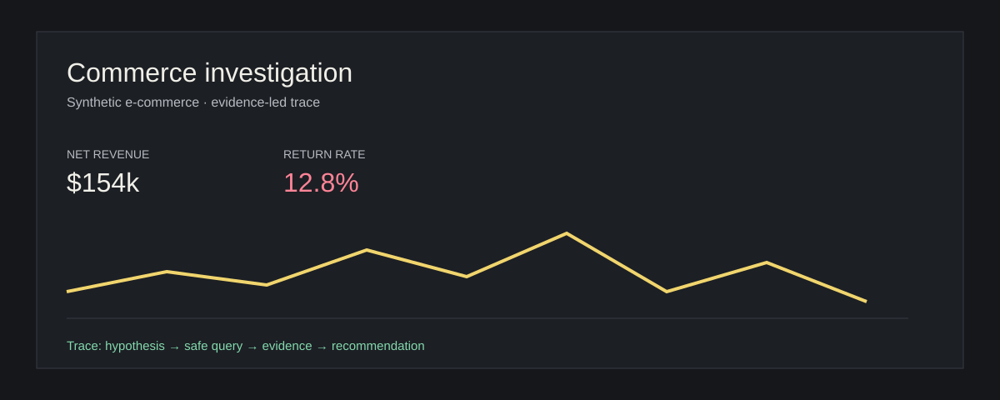

# BI Agent — evidence-led commerce investigations

> Detects unusual commerce performance, tests bounded hypotheses against DuckDB, and produces an auditable morning briefing with evidence, caveats, and sized next actions.



## Demo

Run the app with its built-in synthetic dataset, or import the public Olist snapshot as described below. Open `http://127.0.0.1:8000` and select **Run investigation**. No API key is required. The investigation trace shows the bounded comparisons and their outcomes.

## Results

The evaluator runs the analytics against generated incident and clean-control fixtures; it is not evidence of performance on live customer systems. It reports observed synthetic-fixture detection, segment match, false-alarm, and compute-cost results separately from the original 24-scenario contract catalog. See [evaluation notes](docs/eval-results.md).

## Quickstart: synthetic demo

Requires Python 3.11 or newer. On Windows, from PowerShell in the project directory:

```powershell
py -3.12 -m venv .venv
.\.venv\Scripts\python.exe -m pip install -r requirements.txt
.\.venv\Scripts\python.exe -m app.seed
.\.venv\Scripts\python.exe -m uvicorn app.main:app --reload --no-access-log
```

Then open [http://127.0.0.1:8000](http://127.0.0.1:8000). Run tests with `.\.venv\Scripts\python.exe -m pytest -q` and refresh the fixture benchmark with `.\.venv\Scripts\python.exe -m evals.run_evals`. If `py -3.12` is unavailable, install Python 3.11+ and open a new PowerShell window.

## Import a public real-world dataset

The app supports an extracted copy of the [Brazilian E-Commerce Public Dataset by Olist](https://www.kaggle.com/datasets/olistbr/brazilian-ecommerce). Download it from Kaggle yourself, review its current terms, and extract the CSV files into a local folder. The import needs these files: `olist_orders_dataset.csv`, `olist_order_items_dataset.csv`, `olist_products_dataset.csv`, and `olist_customers_dataset.csv`. `product_category_name_translation.csv` is optional.

Create a separate database file for the import; the command refuses to overwrite an existing file:

```powershell
.\.venv\Scripts\python.exe -m app.import_olist --input-dir "C:\path\to\extracted\olist" --database "data\olist.duckdb"
$env:BI_AGENT_DB = (Resolve-Path "data\olist.duckdb").Path
.\.venv\Scripts\python.exe -m uvicorn app.main:app --reload
```

In another PowerShell window, set the same database environment variable before running the tests or API commands. To switch back to the synthetic demo, clear it with `Remove-Item Env:BI_AGENT_DB`.

The importer includes delivered orders with valid purchase dates and item rows. Revenue is the sum of item prices and excludes freight; multi-category orders are grouped as `Mixed`. Olist does not provide return labels, device, discount rate, sales channel, or marketing spend. Those measures are left unavailable, and return-rate findings are disabled rather than treated as zero. Dataset provenance, row counts, data-quality counts, and limitations appear in the API and UI. This is a static local snapshot, not an integration with a live store.

## How it works

1. `app/seed.py` creates repeatable synthetic orders with known recent fulfillment and discount incidents.
2. `agent/detector.py` applies robust MAD-based daily anomaly checks; it never calls an LLM.
3. `agent/investigator.py` uses a bounded planning-and-tool loop. SQL is SELECT-only, read-only, row-limited, logged, and guarded by step/query/time/cost budgets.
4. `agent/reporter.py` turns findings into an evidence-linked briefing. Recommendations carry observed-period impact estimates and explicit assumptions.
5. The browser UI presents source-aware metrics, detected anomalies, the investigation trace, report content, and fixture evaluator results. Recent investigations can be reopened and exported as JSON or CSV. A configurable threshold monitor evaluates saved reports; rules stay in the browser and do not send notifications. The revenue forecast projects a 14-day linear trend from 28 calendar days of observed revenue and includes an explicitly approximate planning range, not a confidence guarantee.

The planner is provider-neutral and deterministic today. It does not call an LLM. The local demo uses DuckDB; cloud-demo mode uses Supabase Auth/PostgreSQL and applies tenant RLS policies. The Shopify connector uses OAuth plus verified webhooks and only stores a limited set of order fields.

## Design choices

- **Synthetic data first:** supports repeatable testing without touching customer data.
- **Deterministic detection:** cheap, inspectable, and stable across runs.
- **No causal overclaiming:** segment movement is treated as evidence to test, never proof of cause.
- **Guardrails first:** tool access is constrained even though the sample data is local.

Read the [architecture](docs/architecture.md), [data-source mapping](docs/data-sources.md), [evaluation limitations](docs/eval-results.md), [security model](docs/security.md), and [free demo deployment](docs/deployment.md). Run locally with Docker Compose using `docker compose up --build`; the app is published only on localhost, health-checked, and the `data` folder is persisted on the host. CI runs tests and the fixture benchmark on pushes and pull requests.

To select an imported Olist database in Docker Compose after creating `data\olist.duckdb`, set `$env:BI_AGENT_DB_CONTAINER = "/app/data/olist.duckdb"` before `docker compose up --build`. Clear that variable to return to the synthetic database.

## Free demo and readiness boundary

The cloud-demo mode adds user authentication, database-enforced tenant isolation, Shopify OAuth/webhook ingestion, privacy-event handling, request metrics, health checks, and optional Sentry error reporting. Its intended use is a free portfolio demo with synthetic/test-store data. Render's free web service sleeps after inactivity and has ephemeral local storage; Supabase's free project can pause after inactivity and has resource limits. These free tiers have no production SLA or operational support. Do not use this deployment for real customer workloads or sensitive business data.

The Shopify integration has not been installed against a real store in this environment. It requires a Shopify app registration and a development store, and must be end-to-end tested before claiming a verified live integration.

## 30-second pitch

“BI Agent is an evidence-led commerce analytics demo. It ingests a limited set of Shopify order fields, applies deterministic comparisons, and presents inspectable evidence with explicit data boundaries. Authentication and Postgres row-level security isolate workspaces. This is a free-tier portfolio deployment, not a production service or a validated performance claim.”
